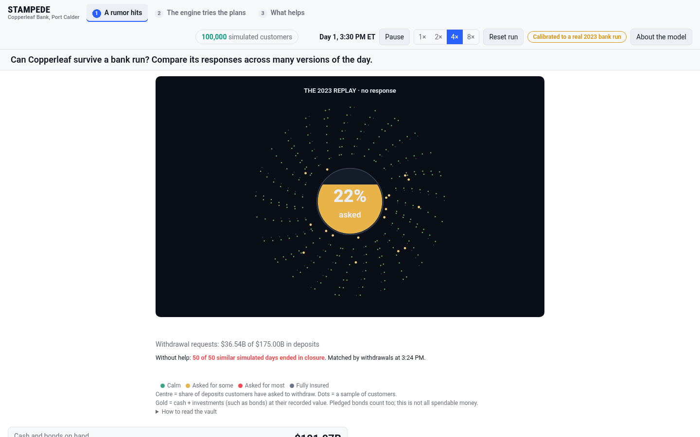
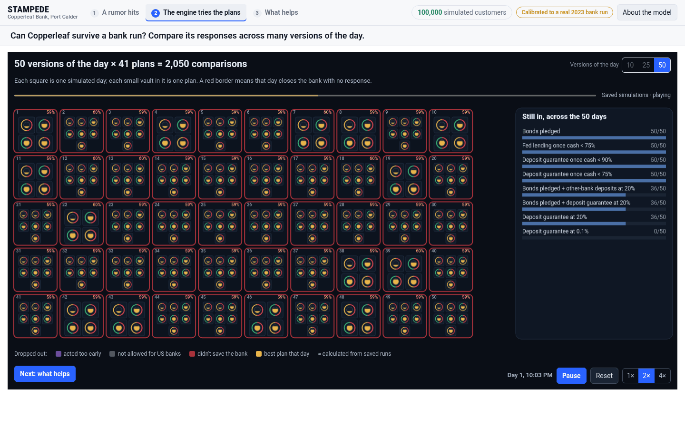
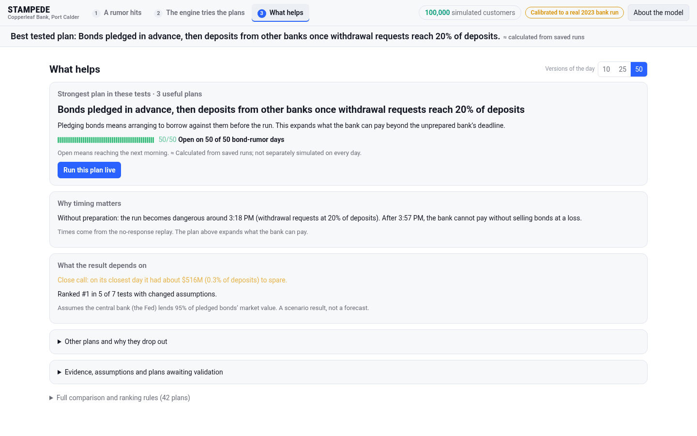

# STAMPEDE: a GPU-accelerated bank-run simulator

STAMPEDE simulates a bank run minute by minute. A rumor spreads through a network of 100,000 depositors. Each depositor decides whether to ask for their money, the withdrawal requests drain the bank's cash, the bank sells or pledges bonds from a modeled balance sheet, and its stock trades in a limit order book. The behavioral parameters are fit with CMA-ES to Silicon Valley Bank's run in March 2023 and then checked, without refitting, against Signature Bank's run the next day. A response search then runs crisis-response plans (pledging bonds, borrowing, deposit guarantees, each with a trigger) across many seeded versions of the same day and ranks what actually keeps the bank open.

It is a stress-testing and teaching tool, not a forecast. Results are reported over seeded runs (how many of 50 days a plan saves, closest margins), not as one prediction. The bank in the UI, Copperleaf, is fictional.

| 1. A rumor hits | 2. The engine tries the plans | 3. What helps |
|---|---|---|
| [](docs/img/beat1-rumor.png) | [](docs/img/beat2-plans.png) | [](docs/img/beat3-what-helps.png) |
| The calibrated engine running the 2023 bond-loss rumor with no response, 3:30 PM: 22% of deposits requested. | The saved search replaying (10, 25 or 50 versions of the day, manual Play/Reset, 1×/2×/4×): each square is one version of the day, each small vault one plan; plans drop out as they fail or act too early. The answer appears in the headline only when the replay finishes. | The top plan, why timing matters, the close call and the sensitivity checks. "Run this plan live" replays it in beat 1 ([screenshot](docs/img/beat3-plan-live.png)). |

## Results

All runs on an RTX 3060 12 GB under Linux unless noted.

| What | Result |
|---|---|
| **Signature Bank holdout (never in the objective):** share of deposits requested by day-one close | **25.98% simulated vs. 24.9% target, within 1.1 pp** (band ±35% relative) |
| SVB fit (in sample): requested by day-one close | 24.49% vs. 24.9% |
| SVB fit (in sample): requested by the next open | 81.85% vs. 81% |
| SVB fit: settled on day one | 21.85% vs. 24% (inside the ±25% band; see limitations) |
| Placebo: fully insured community bank | survives, as expected |
| One CMA-ES generation (12 candidates × 8 seeds = 96 simulations of 100,000 depositors, 460 ticks) | **13.8 s on the batched CuPy path, down from about 180 s (about 13×)** |
| GPU vs. NumPy reference, 21 (plan, seed) days of 1,441 minutes | **21/21 agree**: same outcome, every response fires within 1 minute, worst end-of-day gap 0.0036 percentage points of deposits. 361 s on the GPU vs. 1,099 s for the 2-worker CPU reference (about 3× wall clock, 6.1× per worker) |
| Winning plan (default 50-day window) | Bonds pledged in advance, then deposits from other banks once withdrawal requests reach 20% of deposits: open on 50 of 50 days, closest margin about $516M (0.3% of deposits), #1 in 5 of 7 changed-assumption tests |
| Response search behind beats 2 and 3 | 321 plans considered, 31 simulated directly, 182 worked out from simulated runs, 111 withheld because their prediction depended on funding the engine had not simulated; 2,320 simulated days of 1,441 minutes; 12,043 s on 6 workers; 3 plans survive the filters |
| Tests | CPU only (`STAMPEDE_OFFLINE=1`, no CUDA): 1,072 passed, 18 GPU tests skipped, 2 xfailed. RTX 3060: 1,056 passed with 2 known failures (see limitations) |

The per-generation timing, tick profile and fit board are recorded in [`docs/svb-fit-verification.md`](docs/svb-fit-verification.md); the parity record is [`data/gpu_parity_vf1.json`](data/gpu_parity_vf1.json); the search results the UI reads are `data/live_search*.json`.

## What the simulation does

```
rumor -> attention -> withdrawal requests -> cash drain -> bond sales / borrowing
      -> realized losses -> stock falls -> news -> more attention
```

- **Clock.** One tick is one business minute. The calendar models the trading day, wire cut-offs, lending-facility hours and the overnight queue until the next open.
- **Rumor network.** A multilayer information network (feeds, group chats, news) stored as one sparse CSR matrix per layer. Attention decays each tick and picks up exposure from every layer, `a <- decay(a) + sum_layer w_layer * (A_layer @ exposure)`, as a CuPy sparse mat-vec on the GPU and a deterministic NumPy mat-vec on the CPU.
- **Depositors.** 100,000 depositors in 7 segments with insured and uninsured balances under the $250,000 FDIC limit. Each one decides once whether to request a withdrawal, from worry, contagion from contacts and their own exposure. Payments go through wire and branch channels with capacity limits and queues.
- **Bank.** A double-entry balance sheet, a bond portfolio with interest-rate risk (Nelson–Siegel curve), and liquidity facilities (discount window, FHLB). When cash runs short the bank must pledge or sell bonds; selling underwater bonds realizes losses.
- **Market.** The bank's stock trades in a limit order book with about 300 traders of five types (value, momentum, short sellers and others); trading halts at the price floor.
- **Regulator.** Closes the bank when it cannot meet requests by the next open.
- **Determinism.** Every random draw comes from seeded Philox streams, so a (scenario, seed) replays identically on the same path.

The live server runs the calibrated modules (network, attention, population, decisions, payments, balance sheet, securities) plus the order book. The repo also contains LLM-driven agents (media, VIP depositors, bank CEOs, short sellers) and a crisis-room "truth filter" that checks every numeric claim in a drafted public statement against the simulated ledger and rejects the whole statement if one claim is false. They run offline as cached or rule-based stand-ins, and the three-beat UI does not use them.

## Calibration

- **Targets (SVB, March 9–10, 2023):** about $42B of deposits requested on day one (a requested share of 0.249), about 81% by the next open, and about 24% settled on day one.
- **Objective:** weighted squared log-error between simulated and target shares, averaged over 8 shared seeds per candidate. Decision gates start as sigmoids around each depositor's breaking point and are annealed toward hard decisions so the objective is smooth early in the search.
- **Search:** a batched sweep brackets the tipping point, then CMA-ES (`cma`) with restarts searches inside it. An identifiability sweep over the 17-coordinate behavioral vector showed only three coordinates move the targets enough to be fit: worry bias, the mobile share of uninsured deposits and the decision-to-request rate. Those are fit; the rest stay at documented priors.
- **Persisted fit** (seed 3060): worry bias −1.737, mobile share 0.9635, decision-to-request rate 0.00210/min, then a second stage solves the payment-capacity multiplier (13.41).
- **Holdout (Signature, March 10, 2023):** NYDFS reports $18.6B withdrawn on day one (20% of deposits) plus about 1,000 pending wires worth $4.6B, which gives a requested share of at least 0.249. Signature is never in the objective; the model gives 0.2598.
- **Every parameter** (513 rows in `params/registry.csv`) is tagged VERIFIED, SOURCED, FITTED or ASSUMED, with its source.

## Engineering

1. **Batched calibration on one 12 GB GPU.** A generation is 96 full simulations. They run as one batched array program instead of 96 processes: attention, contagion, the market quote and payments became CuPy array math, with fused `ElementwiseKernel`s for the depositor step. That took a generation from about 180 s to 13.8 s. CUDA-event profiling of the 26.65 ms tick then showed rumor spread at 8.2 ms, the depositor step at 6.8 ms of GPU time and about 10 ms of unwrapped host code, and a per-tick host sync was removed from the depositor step.
2. **Making the GPU path agree with the CPU reference.** The search ranks plans on outcomes, trigger minutes and margins of 0.3 points and up, so parity is checked in those units: same outcome, every response within 1 minute, and requested deposits within 0.01 points at the end and at every 10-minute sample. All 21 days pass. A float64 version of the same batched code matches the CPU to about 2e-10 relative, which pins the remaining 0.0036-point gap on float32 rounding, not a logic difference.
3. **A fit that wasn't fitting anything.** Diagnostics showed every candidate pinned at the uninsured-deposit ceiling (0.9238) by minute 30: with soft gates every depositor had a nonzero request on tick 1, so contagion jumped to 1. Making each depositor decide once fixed it. An earlier fit with a near-zero objective (0.000124) was thrown out because one parameter set the next-open number directly.
4. **An honest search.** Plans that act on rumors that would have fizzled, or that the engine could not actually simulate, are knocked out or withheld rather than guessed; the result page shows the close call ($516M, 0.3% of deposits, on the closest day) and that the top plan ranks first in 5 of 7 changed-assumption tests.

## Run it

```bash
python -m venv .venv && . .venv/bin/activate
pip install -e '.[dev,server]'
pip install cupy-cuda12x           # optional GPU path; match your CUDA driver

# the three-beat UI against the calibrated engine, fully offline, on the CPU
STAMPEDE_OFFLINE=1 STAMPEDE_MODE=real STAMPEDE_BACKEND=cpu STAMPEDE_PORT=8765 PYTHONPATH=. python -u -m ui.server
# open http://127.0.0.1:8765/ui
```

Beat 1 runs live in the engine (pick one of the preset rumors; typed rumors are off by default). Beats 2 and 3 replay the saved search in `data/`, so they work on a fresh clone without rerunning it. The replay is a canvas renderer with cached sprites; its measured frame-time p95 was about 16.7 ms in Chromium on the development machine.

| Variable | Default | Meaning |
|---|---|---|
| `STAMPEDE_OFFLINE` | `1` | No paid LLM calls; agents use cached or rule-based output |
| `STAMPEDE_MODE` | `fake` | `real` runs the calibrated engine; `fake` plays a scripted arc |
| `STAMPEDE_BACKEND` | `cpu` | `gpu` uses CuPy when installed |
| `STAMPEDE_PORT` | `8000` | Server port |

```bash
STAMPEDE_OFFLINE=1 python -m pytest -q                       # tests, no API key or GPU needed
python -m calibration.run_fit --gpu-full --seed 3060 --population 12 --eval-minutes 1440 --holdout-minutes 780   # refit (GPU, long)
STAMPEDE_MODE=real python scripts/gpu_parity.py --seeds 1-3   # GPU vs. CPU parity
python scripts/pipeline.py                                    # rerun the response search (hours on CPU)
```

## Repository layout

```
engine/        simulation core: clock, network, attention, depositors, payments, bank, liquidity, market, policy; batched GPU paths
calibration/   CMA-ES fit, holdout, identifiability diagnostics
params/        registry.csv: every parameter with its status and source
agents/        LLM agents, the crisis-room truth filter, guardrails, LLM cache
contracts/     Pydantic event and state schemas shared by every module
scenarios/     presets (SVB-like, Signature-like, fictional banks) and replay
ui/            FastAPI server; ui/live/stampede_ui.html is the three-beat UI; ui/crowd and ui/market are React + TypeScript screens
scripts/       search pipeline, parity, benchmarks, run scripts
tests/         pytest + Hypothesis suite
data/          saved search results the UI reads, and the GPU parity record
docs/          ARCHITECTURE.md (full design), fit verification, screenshots
```

Python 3.11+, NumPy, SciPy, CuPy (CUDA 12), Numba, `cma`, Pydantic v2, FastAPI + Uvicorn + WebSockets, React + TypeScript + Vite, pytest + Hypothesis. About 59,500 lines of Python, of which about 21,100 are tests. The full design is in [`docs/ARCHITECTURE.md`](docs/ARCHITECTURE.md).

## Limitations

- **One calibration event.** Three behavioral parameters are fit to SVB and Signature is a single holdout point: evidence the dynamics transfer, not proof. The Signature target is a lower bound, since requests that were never submitted aren't counted.
- **Settled day one is under target.** The second stage plateaus at about 22% settled against 24% (inside the ±25% band, but the exact target is not reachable).
- **The stock is not fitted.** SVB's −60% move on March 9 followed a loss announcement the price path doesn't model, so the stock term has weight 0.
- **Scale.** Calibration and timings are at 100,000 depositors. The design target of 1,000,000 has not been benchmarked at full detail.
- **Assumed effects.** The effects of statements, guarantees and other responses are engine assumptions, not fitted causal estimates; two of the plan types (bonds pledged in advance, deposits from big banks) are worked out from simulated runs and marked ≈ in the UI. Many registry rows are ASSUMED and say so.
- **Saved search provenance.** The saved search took 12,043 s on 6 workers; under the parity rule above, the saved files may mix CPU and GPU runs.
- **Two known test failures on the GPU machine**, an old attention-model fingerprint and a non-bank CUDA price path, reproduce on the earlier baseline; they are disclosed, not fixed.

## Sources

Calibration and holdout targets:
- Barr testimony on SVB withdrawals (CNBC): https://www.cnbc.com/2023/03/28/svb-customers-tried-to-pull-nearly-all-deposits-in-two-days-barr-says.html
- Federal Reserve, *Review of the Federal Reserve's Supervision and Regulation of Silicon Valley Bank* (Apr 2023): https://www.federalreserve.gov/publications/files/svb-review-20230428.pdf
- Michael Barr, testimony before the Senate Banking Committee, May 16, 2023: https://www.federalreserve.gov/newsevents/testimony/barr20230516a.htm
- House Financial Services Committee timeline of the SVB failure: https://democrats-financialservices.house.gov/UploadedFiles/HHRG-118-BA20-20230517-SD002.pdf
- NYDFS statement on Signature Bank: https://www.dfs.ny.gov/reports_and_publications/statements/st20230530

Crisis responses and supervision:
- GAO-23-106736, March 2023 bank failures: https://www.gao.gov/products/gao-23-106736
- FDIC review of the supervision of Signature Bank: https://www.fdic.gov/news/press-releases/2023/pr23033.html
- FDIC OIG, Material Loss Review of First Republic Bank (EVAL-24-03): https://www.fdicoig.gov/sites/default/files/reports/2023-12/EVAL-24-03.pdf
- FINMA, lessons from the Credit Suisse crisis: https://www.finma.ch/en/news/2023/12/20231219-mm-cs-bericht/
- UK Treasury Committee, *The run on the Rock*: https://publications.parliament.uk/pa/cm200708/cmselect/cmtreasy/56/5604.htm

Research on runs and depositor behavior:
- Cookson, Fox, Gil-Bazo, Imbet and Schiller, "Social Media as a Bank Run Catalyst": https://papers.ssrn.com/sol3/papers.cfm?abstract_id=4422754
- Cipriani, Eisenbach and Kovner, "Tracing Bank Runs in Real Time" (NY Fed Staff Report 1104): https://www.newyorkfed.org/research/staff_reports/sr1104.html
- Jiang, Matvos, Piskorski and Seru, "Monetary Tightening and U.S. Bank Fragility in 2023: Mark-to-Market Losses and Uninsured Depositor Runs?" (NBER w31048): https://www.nber.org/papers/w31048
- Martin, Puri and Ufier, "Deposit Inflows and Outflows in Failing Banks: The Role of Deposit Insurance" (NBER w24589): https://www.nber.org/papers/w24589
- Financial Stability Board, press release on interest-rate and liquidity risks and the role of technology and social media in depositor behaviour (Oct 2024): https://fsb.org/uploads/R231024.pdf
- Kazinnik, "Bank Run, Interrupted": https://digitaleconomy.stanford.edu/publication/bank-run-interrupted-modeling-deposit-withdrawals-with-generative-ai
- Rajan, "Social Contagion and Bank Runs: An Agent-Based Model with LLM Depositors": https://arxiv.org/abs/2602.15066

Non-bank market fits (stock and crypto shocks):
- Briola et al., "Anatomy of a Stablecoin's Failure: The Terra-Luna Case": https://arxiv.org/abs/2207.13914
- Liu, Makarov and Schoar, "Anatomy of a Run: The Terra Luna Crash" (NBER w31160): https://www.nber.org/papers/w31160
- Yardeni, S&P 500 bear markets appendix: https://www.yardenibook.com/pub/15.4appendix.pdf
